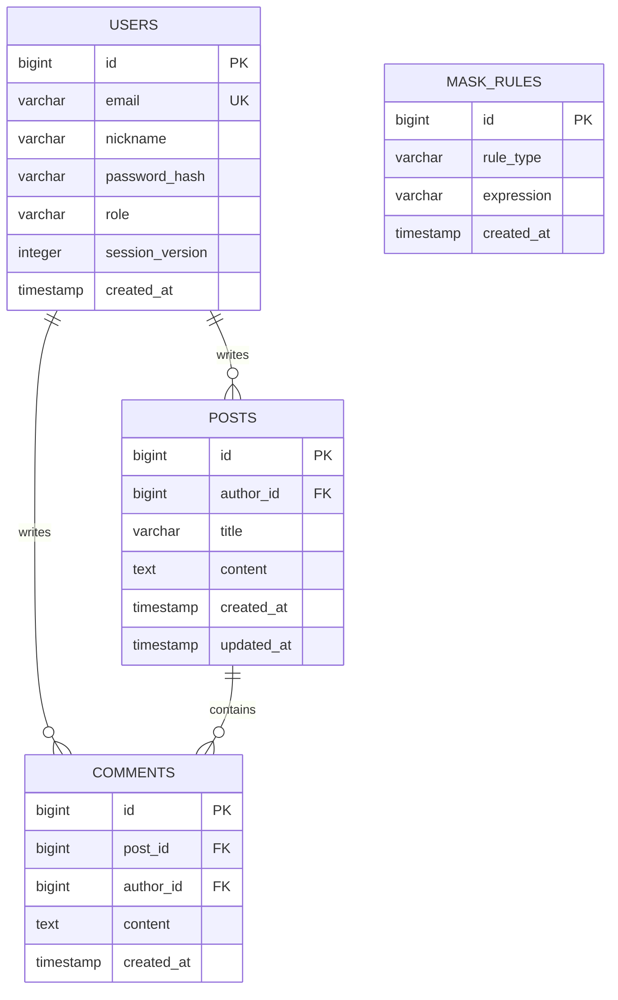

# note-demo 구현용 AI 에이전트 프롬프트

당신은 웹 애플리케이션을 설계·구현·검증하는 AI 개발 에이전트다. 아래 요구사항에 따라 `note-demo`를 실제 실행 가능한 데모로 완성하라. 계획이나 예제 코드만 제시하지 말고 프로젝트 파일, 실행 방법, 검증 결과까지 제공하라.

## 1. 기준과 작업 방식

- 원본 설계안은 같은 디렉터리의 `prompt.md`다. 이 문서는 원본을 실행 가능한 요구사항으로 구체화한 프롬프트다.
- 사용자가 추가로 지정한 배포 대상은 **PythonAnywhere 무료 계정**이다. 구체적인 구현·배포 절차는 `implementation_plan.md`의 최신 수정안을 함께 따른다. 후속 사용자 지시가 원본의 일반적 선택 사항보다 우선한다.
- 작업 전 `prompt.md`, 적용되는 `AGENTS.md`, 기존 소스와 실행 환경을 확인하라. 두 문서 사이에 충돌이 있으면 원본의 명시적 요구사항을 우선하고 차이를 보고하라.
- 기존 사용자 파일과 구조를 확인한 뒤 아래에 지정한 배포 구성에 맞게 구현하라. 기술 선택 이유는 짧게 기록하라.
- 현재 프로젝트의 배포 구성은 Flask + SQLite + HTML/CSS/JavaScript로 지정한다. PythonAnywhere Web 탭의 일반 WSGI 배포를 사용한다. ASGI 실험 배포, Uvicorn 실행, 외부 DB, 별도 백그라운드 서버에 의존하지 마라.
- 원본에 명시된 요구사항, 이 문서가 제안하는 기본 가정, 향후 확장 사항을 구분하라. 기본 가정은 합리적인 구현 선택이며 원본 요구사항으로 표현하지 마라.
- 사소한 선택은 스스로 결정하고 문서화하라. 실행을 막는 충돌이나 필수 정보 부족만 질문하라.
- 기존 사용자 파일을 임의로 삭제하거나 원본 `prompt.md`를 덮어쓰지 마라.
- 사용자 화면과 안내 문구는 한국어를 기본으로 한다.
- 로컬 실행·설치·테스트 안내는 Windows CMD 기준으로 작성한다. 가상환경 활성화는 `call .venv\Scripts\activate.bat`, 실행은 `python`, 환경 변수는 `set`을 사용한다. PythonAnywhere Bash 명령은 서버 콘솔 전용으로 명확히 구분한다.

## 2. 프로젝트 목표와 범위

프로젝트명은 `note-demo`다. 회원가입, 로그인, 로그아웃, 비밀번호 찾기 목업과 게시판을 제공한다. 게시판에는 제목 목록, 페이지네이션, 상세 조회, 본인 글 수정·삭제, 댓글, 불쾌한 표현 마스킹이 있어야 한다. 관리자는 마스킹에 사용하는 표현 규칙을 추가·삭제할 수 있어야 한다.

### 이번 구현에 포함할 기능

1. 이메일, 이름 또는 닉네임, 비밀번호를 입력하는 회원가입.
2. 데모 사용자 인증을 위한 로그인·로그아웃.
3. 비밀번호 찾기 화면과 목업 응답.
4. 게시글 작성, 목록 조회, 상세 조회, 본인 글 수정·삭제.
5. 페이지당 기본 10개 게시글을 표시하는 페이지네이션.
6. 게시글별 댓글 작성과 조회.
7. 키워드 매핑 또는 정규식으로 불쾌한 표현을 찾아 마스킹하는 기능.
8. 인터넷 등의 최신 자료를 조사하여 초기 표현 사전을 구성하는 작업.
9. 관리자 전용 표현 사전 조회·추가·삭제 기능.

### 향후 기능: 이번 구현의 필수 범위에서 제외

- SNS 로그인으로 기존 가입·로그인 방식을 대체하는 기능.
- 실제 운영용 비밀번호 보호와 인증 체계.
- 실제 비밀번호 재설정 메일, 토큰 발급, 비밀번호 변경 절차.

원본은 현재 비밀번호 처리를 목업으로 지정한다. 실사용 자격 증명을 요구하지 말고 데모 전용임을 명확히 하라. 비밀번호를 화면, 로그, API 응답에 노출하지 마라. 운영용 인증이 완성되었다고 설명하지 마라. 실제 인증 라이브러리를 선택하여 안전한 해시 저장을 적용하더라도 이를 구현 선택으로 기록하고 목업과 실제 동작의 경계를 명시하라.

## 3. 원본의 빈 부분을 채우는 기본 가정

아래 항목은 원본의 명시적 요구사항이 아니다. 기존 프로젝트 정책이나 사용자 지시가 없다면 적용하고 README에 기록하라.

- 비로그인 사용자는 게시글 목록·상세·댓글을 읽을 수 있다.
- 로그인한 사용자만 게시글과 댓글을 작성한다.
- 목록은 최신 작성 순으로 표시한다.
- 게시글 목록의 게시글 정보는 제목을 기본으로 하되, 후속 사용자 요청에 따라 로그인한 본인 글에만 `내 글` 배지를 표시한다. 본문 미리보기, 작성자, 날짜 등은 목록에 추가하지 않는다. 페이지 이동 컨트롤과 글쓰기 버튼은 별도로 제공할 수 있다.
- 댓글은 작성과 조회를 최소 범위로 한다. 댓글 수정·삭제는 필수로 추가하지 않는다.
- 마스킹은 게시글 제목·본문과 댓글 내용에 일관되게 적용한다.
- 관리자 권한은 표현 사전 관리용이다. 관리자가 다른 사용자의 게시글을 수정·삭제하는 기능은 추가하지 않는다.
- 일반 사용자와 관리자 데모 계정을 제공한다. 일반 회원가입으로 관리자 권한을 얻을 수 없어야 한다.
- 데이터의 재실행 시 유지 범위와 명시적 초기화 방법을 문서화한다.
- 이번 배포에서는 서버 SQLite에 회원·게시글·댓글·규칙을 저장한다. 브라우저나 서버 메모리를 이 데이터의 기본 저장소로 사용하지 않는다.
- 디자인은 가독성과 기본적인 반응형 사용성을 갖춘 간결한 형태로 한다.

## 4. 기능 상세 및 완료 기준

### R01. 회원가입

- 입력 필드: 이메일 주소, 이름 또는 닉네임, 비밀번호.
- 필수 입력, 이메일 형식, 이메일 중복을 검사한다.
- 비밀번호 길이 등 추가 검증 정책은 과도하게 만들지 말고 선택한 정책을 안내한다.
- 정상 가입 결과와 입력 오류를 사용자가 이해할 수 있게 표시한다.
- 가입 완료 후 로그인 화면으로 이동하는 것을 기본 동작으로 한다.
- 가입 요청에서 역할을 조작해도 관리자 계정이 생성되지 않도록 한다.

### R02. 로그인 및 로그아웃

- 이메일과 비밀번호로 데모 인증을 수행한다.
- 잘못된 인증 정보에는 일관된 오류를 표시한다.
- 인증 상태와 사용자 식별자를 이용하여 작성 및 소유권 검사를 수행한다.
- 로그아웃하면 인증 상태를 지우고 접근 권한을 다시 평가한다.
- 새로고침 시 로그인 유지 여부와 데모 세션의 저장 방식을 문서화한다.
- PythonAnywhere 배포에서는 Flask 서명 쿠키와 `users.session_version`으로 로그인 상태를 검증한다. 최대 8시간 만료, 고정 SECRET_KEY와 DB가 유지되는 Reload에서는 로그인 유지, 로그아웃 시 버전 증가로 해당 계정의 모든 기존 세션 무효화를 적용한다. 역할은 쿠키를 신뢰하지 말고 현재 DB에서 조회한다.
- 서명 쿠키에 비밀번호·해시·비밀값을 담지 않는다. 공개 HTTPS 배포에서는 HttpOnly·Secure·SameSite 설정과 상태 변경 요청의 CSRF 검증을 적용한다.
- 버튼 숨김만으로 권한 검사를 끝내지 마라. Flask 서버에서 인증·소유권·관리자 권한을 검사한다.

### R03. 비밀번호 찾기 목업

- 로그인 화면에서 접근할 수 있는 비밀번호 찾기 화면을 제공한다.
- 이메일 입력과 형식 검사를 제공한다.
- 제출 시 실제 메일이 발송되지 않는 데모 기능임을 명확하게 안내한다.
- 실제 비밀번호 변경이나 메일 발송 성공을 가장하지 마라.
- 이 화면의 존재를 실제 비밀번호 재설정 구현 완료로 보고하지 마라.

### R04. 게시글 작성과 목록

- 게시글 입력 필드는 제목과 내용이다. 공백만 있는 값은 허용하지 않는다.
- 게시글에는 고유 ID와 작성자 ID를 연결한다. 소유권을 닉네임 문자열로 판단하지 마라.
- 목록에는 게시글별 제목과 본인 글의 `내 글` 배지를 표시하고 클릭하면 해당 글의 상세 화면으로 이동한다. 본인 여부는 서버가 현재 세션의 회원 ID와 작성자 ID를 비교하여 판단한다. 비로그인 또는 타인 글에는 배지를 표시하지 않는다.
- 기본 페이지 크기는 정확히 10개다. 별도 변경 UI는 필수가 아니다.
- 전체 개수에 맞게 페이지 이동을 제공한다. 이전·다음 또는 페이지 번호 방식은 선택할 수 있다.
- 게시글이 없을 때 빈 상태를 표시한다.
- 잘못된 페이지 값은 오류 없이 유효한 범위로 처리한다.
- 마지막 페이지의 마지막 글 삭제 후에는 존재하는 페이지로 이동한다.

### R05. 게시글 상세·수정·삭제

- 상세 화면에서 제목과 전체 본문을 읽을 수 있어야 한다.
- 로그인한 작성자 본인에게만 수정·삭제 기능을 허용한다.
- 다른 사용자 계정이나 조작된 작성자 ID로 변경할 수 없어야 한다.
- 수정 화면은 기존 제목과 내용을 표시하고 저장 결과를 상세·목록에 반영한다.
- 삭제 전 확인을 받고 완료 후 목록으로 이동한다.
- 존재하지 않거나 삭제된 게시글에는 안내와 목록으로 돌아가는 경로를 제공한다.

### R06. 댓글

- 게시글 상세에서 해당 글의 댓글 목록과 댓글 작성 기능을 제공한다.
- 로그인한 본인이 작성한 댓글은 닉네임 옆에 `내 댓글` 배지로 표시한다. 서버에서 현재 세션 회원 ID와 댓글 작성자 ID를 비교하며 닉네임으로 판정하지 않는다. 비로그인·타인 댓글에는 표시하지 않는다.
- 댓글은 게시글 ID, 작성자 ID와 연결한다.
- 비로그인 작성과 공백 댓글을 차단한다.
- 작성 성공 후 목록을 갱신하고 작성 실패 시 내용을 잃지 않도록 한다.
- 댓글이 없을 때 빈 상태를 제공한다.
- 게시글 삭제 시 연결된 댓글도 함께 제거하거나, 선택한 저장 방식에서 고아 댓글이 남지 않도록 처리한다.

### R07. 불쾌한 표현 마스킹

- 키워드 매핑 또는 정규식 중 하나 이상을 구현한다. 둘 다 반드시 구현할 필요는 없다.
- 일치하는 표현을 `*` 등으로 대체한다. 마스킹 문자와 대체 단위는 일관되게 정하고 문서화한다.
- 한 문장 내 여러 번 등장하는 표현을 모두 처리한다.
- 영문 대소문자, 공백·기호 변형 처리 여부를 명시하고, 지원한다고 주장하는 경우 해당 사례를 검증한다.
- 키워드 모드의 특수문자를 정규식 문법으로 잘못 해석하지 않도록 한다.
- 중복되거나 겹치는 규칙에도 결과가 일관되도록 매칭 순서를 정한다.
- 정규식 입력을 지원하면 잘못된 패턴을 저장 전에 검증하고 과도한 실행 비용을 유발하는 패턴을 제한한다. 안전하게 지원하기 어렵다면 키워드 방식을 선택한다.
- 원문은 수정과 재처리를 위해 저장할 수 있지만 사용자에게 보이는 목록·상세·댓글에는 현재 규칙을 적용한다. 작성자 자신의 편집 입력란에 한해 원문을 제공할 수 있다.
- 관리자가 규칙을 추가·삭제하면 기존 글과 댓글의 표시에도 현재 규칙을 반영한다. 규칙 삭제로 원문 표현이 다시 표시될 수 있음을 관리자에게 안내한다.
- 화면에 사용자 입력을 HTML로 직접 삽입하지 마라. 마스킹은 HTML 이스케이프나 XSS 방어를 대신하지 않는다.
- 모든 불쾌한 표현을 완벽히 검출한다고 주장하지 마라. 오탐과 누락 가능성을 설명한다.

### R08. 초기 표현 사전 조사

- 구현 시점에 웹 검색 등을 사용하여 한국어 중심의 불쾌한 표현·욕설 필터 자료를 조사하고 초기 사전을 구성한다. 기억만으로 최신 자료를 조사했다고 표현하지 마라.
- 이 조사는 배포 전 개발 환경에서 수행한다. 무료 서버의 외부 접근 제한에 대비하여 조사한 규칙을 seed로 배포하고 앱의 시작·요청 처리에서 외부 자료 수집을 하지 않는다.
- 자료의 신뢰성, 갱신 시점, 재사용 조건을 확인한다. 공개되어 있다는 이유만으로 전체 목록을 무단 복제하지 마라.
- 조사한 출처 URL, 확인 날짜, 선정 기준과 사전의 한계를 별도 문서 또는 README에 기록한다.
- 불쾌한 표현 자체를 일반 화면이나 로그에 불필요하게 나열하지 않는다. 관리자가 규칙을 검토하는 화면에는 필요한 표현을 표시할 수 있다.
- 인터넷 접근이 불가능하면 검증된 최신 사전처럼 꾸미지 마라. 소규모 데모 규칙으로 기능을 동작시키고, 최신 자료 조사 요구사항은 미완료로 명시하라.

### R09. 관리자 표현 사전 관리

- 관리자만 접근할 수 있는 관리 화면과 데이터 변경 경로를 제공한다.
- 초기 규칙과 이후 추가한 규칙을 확인할 수 있어야 한다.
- 키워드 또는 지원하는 정규식 규칙을 추가·삭제할 수 있어야 한다.
- 빈 값, 중복 값, 잘못된 정규식 등 지원 방식에 해당하는 입력 오류를 검증한다.
- 일반 사용자·비로그인 사용자의 관리 화면 접근과 직접 변경 요청을 차단한다.
- 변경 후 마스킹 결과가 갱신되고 선택한 저장 방식에 맞게 규칙이 유지되어야 한다.

## 5. 최소 화면과 데이터 관계

### 5.1 화면 구성

화면은 아래 핵심 요소만으로 간단하고 명료하게 구성하라. 공통 상단에는 프로젝트명과 로그인/회원가입 또는 닉네임/로그아웃을 표시하고, 관리자에게만 사전 관리 링크를 표시한다. 별도 대시보드나 장식용 영역은 만들지 않는다.

| 화면 | 핵심 구성 |
| --- | --- |
| 회원가입 | 이메일, 닉네임, 비밀번호, 가입 버튼, 로그인 링크 |
| 로그인 | 이메일, 비밀번호, 로그인 버튼, 회원가입·비밀번호 찾기 링크 |
| 비밀번호 찾기 | 이메일, 제출 버튼, 목업 안내, 로그인으로 돌아가기 |
| 게시글 목록 | 제목 목록, 본인 글의 `내 글` 배지, 페이지 이동, 글쓰기 버튼 |
| 게시글 상세 | 제목, 본문, 목록 버튼, 본인 글의 수정·삭제 버튼, 댓글 목록·입력·등록 버튼 |
| 게시글 작성·수정 | 공통 폼 재사용: 제목, 내용, 저장·취소 버튼 |
| 관리자 사전 관리 | 표현 목록, 표현 입력·추가 버튼, 규칙별 삭제 버튼; 정규식 지원 시에만 유형 선택 |

입력 오류는 해당 필드 근처에, 처리 결과는 짧은 안내로 표시한다. 삭제 확인은 간단한 확인창으로 처리한다. 작은 화면에서도 입력과 주요 버튼을 사용할 수 있게 구성한다. 경로명과 컴포넌트명은 기존 프로젝트 관례에 맞게 정하라.

### 5.2 ERD

아래는 구현할 기본 논리 모델이다. 사용자는 여러 게시글과 댓글을 작성할 수 있고, 게시글에는 여러 댓글이 연결된다. 표현 규칙은 공통 마스킹 서비스가 조회하므로 게시글·댓글과 별도의 연결 테이블을 만들지 않는다.

### 5.3 데이터베이스 테이블 구조

테이블은 `users`, `posts`, `comments`, `mask_rules`의 4개로 구성한다. 아래 자료형은 논리 자료형이다. SQLite에서 PK는 `INTEGER PRIMARY KEY`, 날짜는 동일 정밀도의 UTC ISO 8601 문자열로 대응하고 실제 DDL을 제공하라. 길이 제한은 VARCHAR 선언만 믿지 말고 CHECK와 서버 검증으로 보완한다.

공통으로 모든 컬럼은 `NOT NULL`이며, `id`는 자동 생성 PK, `created_at`은 생성 시각을 기본값으로 한다. 시각은 UTC로 저장하고 화면에서는 사용자 시간대에 맞게 표시한다. 아래 길이 제한은 구현 기본값이며 클라이언트와 데이터 변경 경로에서 동일하게 검증한다.

**users — 회원**

| 컬럼 | 자료형 | 키·기본값·제약 | 용도 |
| --- | --- | --- | --- |
| id | BIGINT | PK, 자동 생성 | 회원 식별자 |
| email | VARCHAR(254) | UNIQUE | 로그인 이메일; 앞뒤 공백 제거·소문자 정규화 후 저장 |
| nickname | VARCHAR(50) | 공백만 입력 불가 | 이름 또는 닉네임; 중복 허용 |
| password_hash | VARCHAR(255) | API 응답·로그·세션 쿠키 노출 금지 | Werkzeug 함수로 생성·검증하는 솔트 포함 비밀번호 해시 |
| role | VARCHAR(10) | 기본값 `USER`, `USER`/`ADMIN`만 허용 | 권한; 회원가입 입력으로 지정 불가 |
| session_version | INTEGER | 기본값 0, 0 이상 | 로그인 시 쿠키에 기록; 매 요청 DB 값과 비교, 로그아웃 시 원자적 증가 |
| created_at | TIMESTAMP | 기본값 현재 시각 | 가입 시각 |

현재 배포 구성은 해시 방식으로 구체화한다. 가입 계정도 재로그인할 수 있어야 한다. 인증은 데모 범위이며 실제 비밀번호 찾기는 계속 목업으로 유지한다. 메모리 세션이나 별도 세션 테이블 대신 `session_version`을 사용하고, 로그아웃 시 같은 계정의 다른 기기도 함께 로그아웃됨을 안내한다.

**posts — 게시글**

| 컬럼 | 자료형 | 키·기본값·제약 | 용도 |
| --- | --- | --- | --- |
| id | BIGINT | PK, 자동 생성 | 게시글 식별자 |
| author_id | BIGINT | FK → users.id, 삭제 RESTRICT | 작성자; 현재 로그인 사용자로 지정 |
| title | VARCHAR(200) | 공백만 입력 불가 | 제목 원문 |
| content | TEXT | 공백만 입력 불가, 최대 10,000자 | 본문 원문 |
| created_at | TIMESTAMP | 기본값 현재 시각 | 목록 정렬 기준 |
| updated_at | TIMESTAMP | 생성 시 현재 시각, 수정 시 갱신 | 최종 수정 시각 |

**comments — 댓글**

| 컬럼 | 자료형 | 키·기본값·제약 | 용도 |
| --- | --- | --- | --- |
| id | BIGINT | PK, 자동 생성 | 댓글 식별자 |
| post_id | BIGINT | FK → posts.id, 삭제 CASCADE | 연결 게시글; 글 삭제 시 댓글도 삭제 |
| author_id | BIGINT | FK → users.id, 삭제 RESTRICT | 작성자; 현재 로그인 사용자로 지정 |
| content | TEXT | 공백만 입력 불가, 최대 2,000자 | 댓글 원문 |
| created_at | TIMESTAMP | 기본값 현재 시각 | 댓글 정렬 기준 |

**mask_rules — 마스킹 표현 사전**

| 컬럼 | 자료형 | 키·기본값·제약 | 용도 |
| --- | --- | --- | --- |
| id | BIGINT | PK, 자동 생성 | 규칙 식별자 |
| rule_type | VARCHAR(10) | 기본값 `KEYWORD`; `KEYWORD`/`REGEX`만 허용 | 키워드 전용 구현은 `KEYWORD`로 고정 |
| expression | VARCHAR(255) | 앞뒤 공백 제거, 빈 값 불가 | 키워드 또는 정규식 패턴 |
| created_at | TIMESTAMP | 기본값 현재 시각 | 규칙 등록 시각 |

- `mask_rules(rule_type, expression)`에 복합 UNIQUE 제약을 둔다. 영문 대소문자를 구분하지 않는 키워드 정책이면 대소문자 정규화 후 중복 검사도 수행한다. 정규식은 대소문자를 임의 변환하지 않는다.
- 마스킹 문자는 기본 `*`로 통일하고 공통 서비스에서 처리한다. 규칙별 대체 문구 편집 기능은 필수가 아니다.
- 정규식 모드를 구현하지 않으면 `REGEX` 규칙의 등록을 거부한다.
- 초기 사전은 seed 데이터로 제공하고 출처·확인 날짜는 문서에 기록한다.

### 5.4 조회·무결성 규칙

- 게시글 목록: `created_at DESC, id DESC`로 정렬하고 페이지당 10개를 조회한다. 동일 시각의 글도 순서가 일정해야 한다. `(created_at, id)` 인덱스를 둔다.
- 댓글 목록: 해당 `post_id`로 제한한 뒤 `created_at ASC, id ASC`로 정렬한다. `(post_id, created_at, id)` 인덱스를 둔다.
- 작성자 FK 조회를 위해 `posts(author_id)`, `comments(author_id)` 인덱스를 둔다. DB가 동일한 인덱스를 자동 생성하면 중복 생성하지 않는다.
- FK와 UNIQUE 제약을 실제로 활성화한다. DB가 검사하지 않는 제약과 공백·길이 검증은 데이터 변경 계층에서 보완한다.
- 회원 탈퇴는 이번 범위에 포함하지 않는다. 작성자가 있는 회원의 직접 삭제는 RESTRICT로 막는다.
- 제목·본문·댓글은 원문을 저장하고 표시할 때 현재 표현 사전으로 마스킹한다. 게시글이나 댓글에 마스킹 결과를 원문 대신 덮어쓰지 않는다.

공통 마스킹 로직을 재사용하고 인증·소유권·관리자 검사를 중복되거나 상충하지 않게 구성하라. 범위 밖의 첨부파일, 검색, 좋아요, 알림, 채팅 등은 임의로 추가하지 마라.

## 6. 검증 시나리오

선택한 스택에 맞는 테스트 또는 실제 실행으로 아래 동작을 확인하라. 권한 검사와 마스킹 로직은 가능한 경우 의미 있는 자동 테스트를 작성한다. 실제로 수행하지 않은 검증은 통과했다고 기록하지 않는다.

1. 정상 회원가입, 필수 값 누락, 잘못된 이메일, 중복 이메일을 각각 확인한다.
2. 정상·실패 로그인, 로그아웃 후 작성 차단을 확인한다.
3. 비밀번호 찾기에서 실제 발송이 없는 목업 안내를 확인한다.
4. 게시글 0개, 1개, 10개, 11개, 21개 상태에서 목록과 페이지 경계를 확인한다. 11개는 10+1, 21개는 10+10+1로 나뉘어야 한다.
5. 목록에 본문 등 추가 게시글 정보가 없고 제목으로 상세 이동이 되는지 확인한다.
6. 사용자 A가 자신의 글을 수정·삭제할 수 있고, 사용자 B는 같은 글을 수정·삭제할 수 없는지 확인한다. 서버가 있으면 직접 변경 요청도 확인한다.
7. 댓글 작성·조회, 공백 댓글 차단, 비로그인 작성 차단을 확인한다.
8. 게시글 제목·본문·댓글에서 단일·반복·겹치는 표현의 마스킹을 확인한다. 지원하는 변형 처리와 일반 문장 오탐 사례도 확인한다.
9. 관리자의 규칙 추가·삭제가 기존 글과 댓글 표시에도 반영되는지 확인한다.
10. 일반 사용자와 비로그인 사용자의 관리자 변경 요청을 차단하는지 확인한다.
11. 존재하지 않는 글, 잘못된 페이지, 마지막 페이지 마지막 글 삭제를 확인한다.
12. 사용자 입력이 HTML이나 스크립트로 실행되지 않는지 확인한다.
13. 새로고침 또는 재실행 후 데이터·인증·사전 규칙이 문서화한 정책대로 동작하는지 확인한다.

## 7. 구현 순서와 산출물

1. 기존 프로젝트와 요구사항을 확인하고 스택, 저장 방식, 목업 경계를 결정한다.
2. 데이터 관계와 인증·권한 검사, 공통 마스킹 로직을 설계한다.
3. 초기 표현 사전을 조사하고 출처를 기록한다.
4. 회원 기능, 게시판, 댓글, 관리자 사전 관리 화면과 동작을 구현한다.
5. 검증 시나리오를 실행하고 발견한 문제를 수정한다.
6. README에 설치·실행 명령, 필요한 환경 설정, 데모 계정, 저장·초기화 방법, 목업 범위, 채택한 기본 가정, 조사 출처, 검증 방법을 기록한다.
7. PythonAnywhere 무료 배포용 WSGI 진입점, 최소 실행 의존성, 비밀값 없는 설정 예제와 배포 가이드를 제공한다. 실제 계정에서 배포 검증하지 못했으면 배포 준비 완료와 실제 배포 완료를 구분한다.

최종 응답에는 실행 방법, 구현된 기능, 실제 검증 결과, 남은 제약을 간결하게 보고하라. R01~R09 각각에 대해 구현 위치와 검증 근거를 연결한 요구사항 대응표를 프로젝트 문서에 남겨 누락 여부를 확인할 수 있게 하라. 목업을 실제 운영 기능으로, 조사하지 않은 사전을 최신 사전으로, 실행하지 않은 테스트를 통과 결과로 표현하지 마라.

## 8. PythonAnywhere 무료 배포 조건

- 배포는 Web 탭의 일반 WSGI 앱으로 구성한다. `wsgi.py`에서 `application = create_app()`을 노출하고 PythonAnywhere가 생성한 WSGI 설정에서 이를 import한다. import 과정에서 `app.run()`, DB 초기화, seed 재주입, 외부 수집을 실행하지 않는다.
- Web 앱과 가상환경의 Python 버전을 일치시킨다. Flask 등 실행 패키지만 배포용 requirements에 넣고 테스트 패키지는 개발용 파일로 분리한다. Node 빌드 과정이나 Docker를 필수로 하지 않는다.
- `DATABASE_PATH`는 홈 디렉터리 아래 DB의 절대 경로로 지정하고 상위 폴더의 쓰기 권한을 확인한다. SQLite 연결마다 FK를 활성화하고 짧은 트랜잭션·제한된 잠금 대기를 사용한다. WAL을 자동 활성화하지 않는다.
- 고정 SECRET_KEY 등 실제 설정은 정적 경로·소스·배포 압축 파일 밖의 비공개 파일에서 읽는다. 콘솔 환경 변수가 WSGI에 자동 적용된다고 가정하지 않는다. debug는 끈다.
- 정적 파일 매핑은 `/static/`과 실제 정적 폴더만 연결한다. DB·비공개 설정·프로젝트 루트는 공개하지 않는다.
- DB 초기화와 관리자 생성은 명시적 콘솔 명령으로 제공한다. 공개 관리자 비밀번호는 로컬 데모 값과 별도로 지정하며 README에 실제 값을 쓰지 않는다. 코드 업데이트 시 DB·SECRET_KEY를 유지한다.
- 새 무료 계정에 MySQL·예약 작업이 제공된다고 가정하지 않는다. 외부 API·크롤링·예약 수집 없이 동작하도록 하고, DB 백업과 앱 만료 연장은 수동 절차로 문서화한다.
- 무료 계정의 워커·디스크·웹 앱 만료 조건은 배포 시 공식 안내와 계정 대시보드에서 확인한다. 이 앱은 소규모 데모로 설계한다.
- 배포 가이드에 업로드, 가상환경, 설정 로딩, DB 최초 생성, Web/WSGI 설정, 정적 매핑, Reload, 오류 로그 확인, 백업·복구를 포함한다. 로컬 실행 절차와 배포 절차를 구분한다.
- 배포 환경에서는 HTTPS, 정적 파일, 권한 검사, 마스킹과 Reload 후 데이터·로그인 유지 여부를 확인한다. 실제 배포·검증이 불가능한 경우 미실행 항목을 명시한다.
