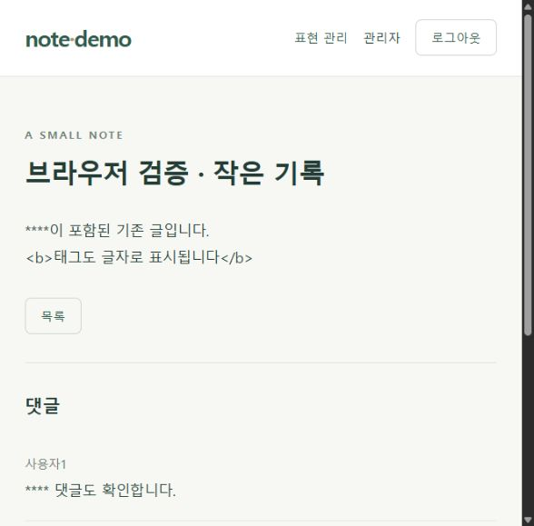

# 검증 기록

실행일: 2026-10-27. 실행 환경: Windows, Python 3.13.12, 프로젝트 `.venv`, Flask 3.1.3, pytest 9.1.1.

## 자동 테스트

실행 명령:

```bat
.\.venv\Scripts\python.exe -m pytest -q
```

최종 결과: **65 passed in 9.72s** (`내 댓글` 배지 추가 후). 테스트에는 별도 임시 SQLite DB를 사용했다. 최초 샌드박스 실행에서는 Windows 임시 폴더 접근 권한으로 실패했으며, 권한을 허용받아 같은 테스트 명령으로 정상 실행했다. 해당 초기 환경 오류를 앱 테스트 통과로 집계하지 않았다. `pip check`도 의존성 충돌 없이 통과했다.

댓글 배지 검증: 비로그인·사용자 A·사용자 B·관리자의 댓글 소유권을 각각 확인했다. 같은 닉네임이어도 회원 ID로 판정하며 쿼리의 user_id 조작은 무시한다. 로그아웃 후 본인 표시가 사라지는 것도 확인했다.

추가 검증: 비로그인·사용자 A·사용자 B·관리자의 목록 소유권 표시를 비교하고, 쿼리의 user_id 조작에 영향받지 않으며 로그아웃 후 모든 본인 표시가 사라지는지 확인했다. 기존 페이지 크기와 제목 마스킹은 유지된다. 브라우저에서도 비로그인·다른 작성자의 글에 배지가 없고, 사용자 A로 로그인하면 자신의 글 제목 옆에 `내 글`이 표시되는 것을 확인했다. 화면 기록은 `screenshots/my-post-badge.png`다.

검증 항목: 가입·중복·입력 검증·역할 주입 차단, 로그인 실패·CSRF·출처, Reload에 준하는 앱 재생성과 쿠키 유지, 로그아웃 후 이전 쿠키 재사용 차단, 8시간 만료, 찾기 목업의 DB 불변, 0/1/10/11/21개 페이지 경계, 제목만 반환, 잘못된 페이지 보정, 본인 글 변경·타인/관리자 변경 차단, 댓글 작성·정렬·CASCADE, 키워드 반복·겹침·리터럴·대소문자, 기존 글·댓글 재마스킹, 관리자 CRUD 권한, FK·CHECK, 기존 DB 초기화 거부, SQLite 백업·덮어쓰기 방지, WSGI import, Secure 쿠키·허용 호스트, 화면·정적 경로, 비공개 파일 접근 차단.

## 실제 브라우저 확인

추가 장애 확인: 5000번 포트에서 이전 코드의 개발 서버가 남아 목록 API에 `is_mine`이 없는 응답을 반환하고 있었다. 남아 있던 프로젝트 개발 서버를 정리하고 최신 코드로 5000번 서버를 재시작했다. 사용자1로 로그인하여 기존 `1111` 게시글 옆에 `내 글` 배지가 표시되는 것을 확인했다. 로컬 README 실행 명령에는 코드 변경을 반영하는 `--reload`를 추가했다. 결과 화면은 `screenshots/my-post-badge-fixed-5000.png`에 저장했다.

로컬 개발 서버 `http://127.0.0.1:5000`에 접속하여 다음을 직접 확인했다.

- 목록에 제목과 페이지 이동이 표시되고 본문·작성자·날짜 미리보기가 없는 상태.
- 데모 일반 계정 로그인과 닉네임·로그아웃 메뉴 표시.
- 글쓰기 폼을 통한 게시글 저장과 상세 화면 이동.
- 댓글 등록과 성공 후 입력창 초기화.
- 본문에 입력한 `<b>...</b>`가 HTML로 실행되지 않고 글자로 표시됨.
- 관리자 로그인 후 표현 사전에 시험용 키워드 추가.
- 추가 전 작성된 글과 댓글의 시험용 키워드가 모두 `****`로 표시됨.
- 관리자가 다른 사용자의 글을 읽을 때 수정·삭제 버튼이 표시되지 않음.
- 약 588px 폭의 실제 미리보기에서 입력과 주요 버튼이 배치됨. 더 다양한 모바일 기기 테스트는 미실행.

브라우저 검증을 위해 로컬 데모 DB에 글 1개·댓글 1개·시험 규칙 `검증표현`이 추가되어 있다. 초기 seed 자체는 게시글 21개·표현 20개이며 테스트는 이 초기 상태에서 별도로 수행했다.



## 실행 도구와 설치 확인

가상환경에서 Flask 및 pytest 설치를 확인했고 `configure.py`와 `init_db.py --demo`를 실제 실행했다. 설정은 `.local/config.json`, 로컬 DB는 `data/note_demo.db`에 생성되며 버전 관리에서 제외된다. 실제 비밀값은 문서에 기록하지 않았다.

## 미실행 및 한계

- 실제 PythonAnywhere 계정 업로드·Web 탭·WSGI·정적 매핑·Force HTTPS 설정 및 공개 URL 점검은 미실행이다. README의 공식 자료를 따른 배포 준비 상태다.
- 실제 호스팅 환경의 부하·SQLite 파일 잠금·시간별 자원 사용량은 측정하지 않았다.
- SMTP 메일·SNS 로그인·실제 비밀번호 재설정은 요구 범위 밖이다.
- 네트워크 전송 실패 시 댓글 입력 유지의 모든 장애 조건은 브라우저에서 재현하지 않았다. 입력은 성공 응답과 목록 갱신 이후에만 비우도록 구현했다.
